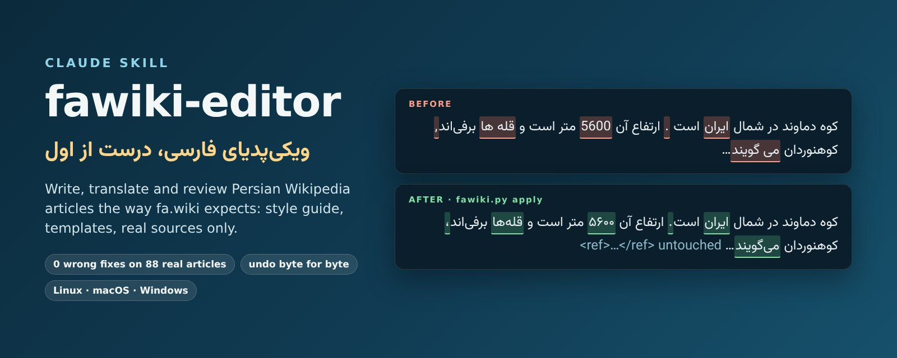
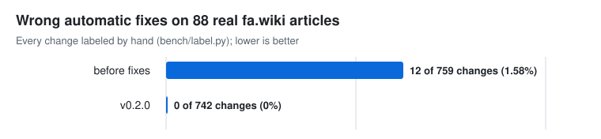
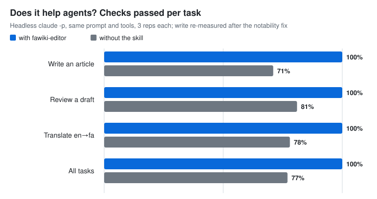

<p align="center"></p>

#  fawiki-editor

**Persian Wikipedia articles that survive review: right orthography, fa.wiki templates, real sources only.**

[](https://github.com/googool2/fawiki-editor/actions/workflows/ci.yml)
[](CHANGELOG.md)
[](LICENSE)
[](skills/fawiki-editor/SKILL.md)

[فارسی](README.fa.md)

Drafts written for Persian Wikipedia by general-purpose models get reverted for the same
reasons again and again: Arabic «ي/ك» instead of Persian «ی/ک», missing نیم‌فاصله, Latin
digits, English templates, invented citations, promotional tone, topics that fail
notability, translations with no attribution. fa.wiki even has a speedy-deletion criterion
(ع۱۵) for unreviewed LLM text. fawiki-editor gives Claude fa.wiki's own conventions and a set
of deterministic tools, so the mechanical part is never left to memory and the judgment
part is honest. **fawiki-editor: the Persian layer for Wikipedia work.**

## What it does

| Task | What you get |
|---|---|
| Write a new article | A notability verdict first, then a draft with `{{مدرک}}` wherever no real source was seen |
| Translate from en.wiki | Persian wikitext with fa.wiki templates, plus the edit summary and `{{صفحه ترجمه‌شده}}` box |
| Review a draft | Orthography fixes with ids, structure errors, content issues (peacock words, BLP, sources) |
| Build a citation | `{{یادکرد وب/کتاب/ژورنال}}` from a URL, DOI or ISBN; nothing guessed |
| Build an infobox | One of ten fa.wiki infoboxes from simple YAML/JSON |
| Explain a deletion | The likely criterion (ع۱۱، ع۱۲، ع۱۵، م۷…) and honest next steps |

## Quick start

**Claude Code, as a plugin** (recommended)

```text
/plugin marketplace add googool2/fawiki-editor
/plugin install fawiki-editor@fawiki-tools
```

**Claude Code, as a personal skill**

```bash
git clone https://github.com/googool2/fawiki-editor
cp -r fawiki-editor/skills/fawiki-editor ~/.claude/skills/
```

**claude.ai**: zip the skill folder and upload it under Settings → Capabilities → Skills.

```bash
cd fawiki-editor/skills && zip -r ../fawiki-editor.zip fawiki-editor
```

**Codex CLI**: `cp -r fawiki-editor/skills/fawiki-editor ~/.agents/skills/`

Use one install method, not two. Requirements: Python 3.10+; `mwparserfromhell` is optional.
Then just ask: «یه مقاله ویکی‌پدیا فارسی درباره پل خواجو بنویس», «این مقاله رو طبق شیوه‌نامه
ویکی‌فا چک کن», «یادکرد وب برای این لینک بساز».

## How it works

Claude reads a ~1.5k-token SKILL.md, loads only the reference it needs (orthography,
titles, dates, citations, infoboxes, structure, notability, translation), and runs the
scripts. The model sees short summaries, not raw files. A real excerpt:

```text
$ python3 skills/fawiki-editor/scripts/fawiki.py report article-bad.wikitext
fa_lint 0.2.0: article-bad.wikitext: 7 change(s), 0 warning(s)
  FA01 arabic-yeh             x1   ids 1          lines 2  e.g. «ايران» → «ایران»
  FA02 arabic-kaf             x1   ids 2          lines 8  e.g. «كوه» → «کوه»
  FA04 latin-digits           x1   ids 3          lines 11  e.g. «5600» → «۵۶۰۰»
  FA20 zwnj-mi                x1   ids 4          lines 12  e.g. «می گویند» → «می␌گویند»
  FA21 zwnj-ha                x1   ids 5          lines 11  e.g. «قله ها» → «قله␌ها»
  FA30 persian-comma          x1   ids 6          lines 12  e.g. «است, ولی» → «است، ولی»
  FA40 space-before-punct     x1   ids 7          lines 8  e.g. «است .» → «است.»
wikitext_check 0.2.0: article-bad.wikitext: 3 error(s), 0 warning(s)
  E WC06 x1 lines 2: lead sentence has no bold title ('''عنوان''')
  E WC03 x1 lines 12: <ref> without </ref>
  E WC05 x1 lines 19: no category: add at least one [[رده:...]] at the end
```

`scan` plans (writes nothing), `apply` applies all changes or `--only 1-4,9`, `undo` restores
the file byte for byte. Rules come from fa.wiki's style guide and from the code of fa.wiki's
own tools (the cosmetic-changes bot, the ابرابزار gadget, the اشتباه‌یاب lists); every rule in
`references/` cites its source or is marked `[UNVERIFIED]`.

## Benchmarks

### On real articles

88 real fa.wiki articles (48 in wikitext from a ~2014 snapshot, 40 random plain-text extracts
from 2017; text not redistributed). Every rule ran, then every automatic change was labeled by
hand and the labels were written down as rules (`bench/label.py`) so the count can be repeated.

| Article type | Articles with ≥1 non-whitespace fix | Non-whitespace fixes per 1,000 characters |
|---|---|---|
| Wikitext | 62% | median 0.12 (IQR 0–0.50, max 5.9) |
| Plain text | 60% | median 0.16 (IQR 0–0.55, max 6.0) |

Whitespace-only fixes (double and trailing spaces) are 60% of all changes and are left out of
the table above; they are real but they are not why articles get reverted.

### Accuracy and safety by version

<picture>
  <source media="(prefers-color-scheme: dark)" srcset="assets/charts/realworld-dark.svg">
  
</picture>

| Same 88 articles | Before rehearsal fixes | v0.2.0 |
|---|---|---|
| Automatic changes | 759 | 742 |
| Wrong | 12 (1.6%) | **0** |
| Debatable | 9 | 4 |
| Protected regions changed, files not restored by undo | 0 | 0 |
| Lint time, all 88 articles | 0.55 s | 0.57 s |

The 12 wrong changes came from four patterns: Latin digits in English bibliographies, a dot
used as a thousands separator read as a decimal («۷۰۰.۰۰۰»), a full stop glued onto an
ellipsis, and abbreviations split apart («ه.ق»). All four are fixed and covered by tests
(details in the [CHANGELOG](CHANGELOG.md)).

### Does it help agents?

<picture>
  <source media="(prefers-color-scheme: dark)" srcset="assets/charts/agents-dark.svg">
  
</picture>

Headless `claude -p` runs on the same fixtures, same prompt, same tools, 3 tasks × 3 reps per
setting, graded by script (`bench/agents.py`):

| | With the skill | Without |
|---|---|---|
| Checks passed | **95.7%** | 76.8% |
| Median time | 44 s | 36 s |
| Median turns | 9 | 3 |
| Median tokens | 184k | 60k |
| Median cost per task | $0.29 | $0.14 |

What the baseline missed in every run: disclosing AI use to the user, the `{{صفحه ترجمه‌شده}}`
attribution for translations, and (in 2 of 3 reviews) it edited a parameter inside an existing
`{{یادکرد وب}}`. What did **not** go as planned: the gain is +18.9 points, short of the +20 the
design aimed for, it costs about twice as much, and in the writing task the skill never stated
a notability verdict. SKILL.md has been changed so the verdict is part of every delivery; that
change has not been re-measured yet.

Triggering: 10/10 on `evals/triggers.json` and 8/8 on a harder near-miss set, 3 runs each
(`docs/eval-results.md`).

### Synthetic benchmark (CI)

`bench/bench.py` builds drafts full of planted errors and traps (Arabic quotes, URLs with
commas, ISBNs, table attributes, «Windows 10», «میز», «جام می», links with a ZWNJ after
them…), applies every rule, then checks that all 16 planted errors are fixed, all 36 traps are
untouched, protected regions and the template/link inventory are byte-identical, a second run
changes nothing, and undo restores every file, CRLF included. It runs on Linux, macOS and
Windows with Python 3.10 and 3.13, with and without `mwparserfromhell`.

## Safety rules

- Never edits Wikipedia; output is wikitext you publish yourself.
- Never invents URLs, ISBNs, DOIs, pages or quotes; unknown fields stay empty.
- Templates, links, `<ref>`, comments, URLs, `<math>`, tables and Arabic blocks are never
  modified, and a post-run assertion fails loudly if one byte inside them changes.
- Ambiguous cases («تر», «ه ی», straight quotes, honorifics, «۷۰۰.۰۰۰») are warnings, never
  automatic fixes: no answer means no change.
- `apply` keeps a backup and a SHA-256 journal; `undo` refuses to overwrite later edits.

## Manual use

```bash
S=skills/fawiki-editor/scripts
python3 $S/fawiki.py scan draft.wikitext          # plan only
python3 $S/fawiki.py apply draft.wikitext --only 1-4
python3 $S/fawiki.py undo draft.wikitext
python3 $S/fawiki.py cite 978-964-8165-81-4 --offline
python3 $S/fawiki.py infobox --template film --skeleton
python3 $S/fa_lint.py --list-rules
```

## Versions and roadmap

See the [CHANGELOG](CHANGELOG.md) for the semver policy (a minor release never loosens safety).
Next: re-measure the writing task after the notability change; verify `[LOW]` template
parameters against live TemplateData once wikipedia.org is reachable; more infoboxes; an
opt-in mode that lints link labels.

## Limits

- **Who reviewed it:** the rules, the labels on the 88 articles and the grading were done by
  Claude, the model that built the skill. No native fa.wiki editor has reviewed it yet; issues
  and corrections are welcome.
- **No live fa.wiki access during research.** Rules come from search excerpts of fa.wiki pages
  and from fa.wiki's tool code; `[LOW]`/`[UNVERIFIED]` items are listed in
  [`docs/research-summary.md`](docs/research-summary.md). Infobox parameter names are mostly `[LOW]`.
- **Corpus:** the wikitext set is from about 2014 and leans toward US entertainment
  biographies; current articles may show fewer errors and different false positives.
- **Tested on:** Linux, macOS and Windows in CI; manual runs on Linux only. Not tested inside
  claude.ai or Codex, only in Claude Code.
- The scripts cannot tell whether a page, category or template exists on fa.wiki.

## Relation to Wikipedia-AI-Skills

[fuzheado/Wikipedia-AI-Skills](https://github.com/fuzheado/Wikipedia-AI-Skills) covers general
Wikimedia tooling (AST parsing, CS1 citations, quality scores, APIs). fawiki-editor adds only
what is specific to Persian Wikipedia, works on its own, and points Claude to that collection's
`wikimedia-wikitext` skill for AST-level work when it is installed.

## Credits and license

MIT ([LICENSE](LICENSE)). The verb-stem list and the misspelling subset come from
[PersianWikipedia/fawikibot](https://github.com/PersianWikipedia/fawikibot) (MIT, © Persian
Wikipedia), credited line by line in `scripts/data/`. Citation parameter names were checked
against [5j9/citer](https://github.com/5j9/citer). Images use the Vazirmatn font (OFL).
